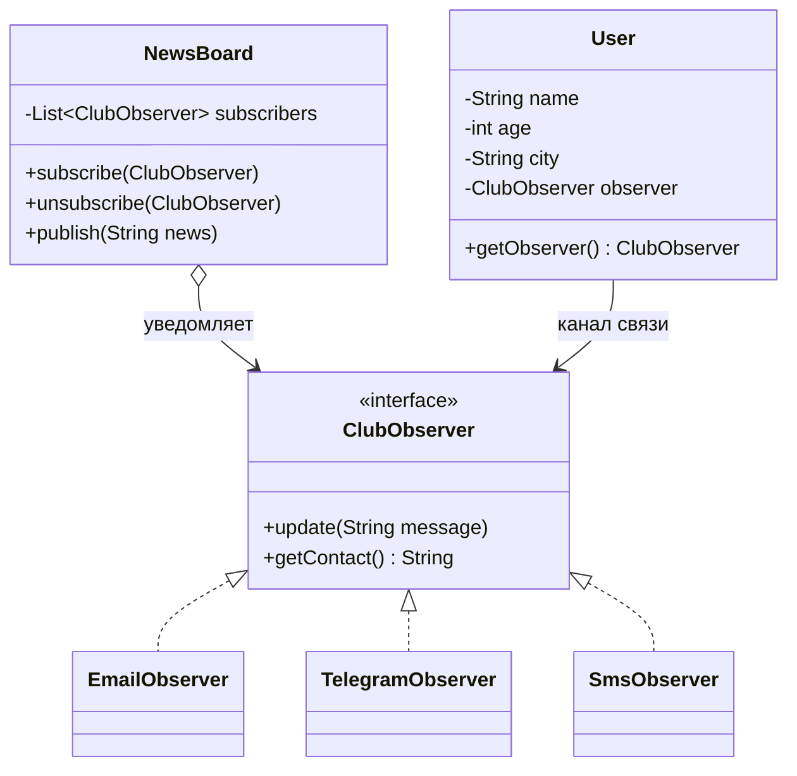

# Группа MD1 A - Рефакторинг растущей цепочки if/else (паттерн Observer)

Курс: Разработка приложений с использованием шаблонов проектирования.
Команда: Ctrl+Alt+Elite.
## Наша задача

Мы получили проект BookLoversClub (клуб знакомств молодых книголюбов). В нём есть
`NotifierFactory` с цепочкой `if / else if`, которая растёт каждый раз, когда мы
добавляем новый канал связи (email, Telegram, SMS). Наша задача — избавиться от
этой цепочки с помощью паттерна проектирования **Observer**.

## Структура репозитория

- `before/Main.java` — код до рефакторинга (`NotifierFactory` с `if / else if`).
- `after/Main.java` — код после рефакторинга (паттерн Observer).

## Проблема в коде "до"

- Чтобы добавить новый канал связи, нужно изменить `NotifierFactory.create()` и дописать ещё одну ветку `else if`.
- `User` хранит канал связи в виде строки (`"email"`, `"sms"`, `"telegram"`), и каждый раз по этой строке выбирается нужный класс.
- Нарушается принцип открытости/закрытости (Open/Closed Principle).

## Решение: паттерн Observer

- `ClubObserver` — интерфейс наблюдателя (`update(String message)`, `getContact()`).
- `EmailObserver`, `TelegramObserver`, `SmsObserver` — конкретные наблюдатели, то есть каналы связи.
- `NewsBoard` — издатель: хранит список подписчиков и рассылает им новости (`subscribe`, `unsubscribe`, `publish`).
- `User` хранит свой канал связи как объект `ClubObserver`, а не как строку.
- `NotifierFactory` больше не нужна и удалена.

## Что улучшилось

- Новый канал связи (например, WhatsApp) — это один новый класс. Остальной код не меняется.
- Нет цепочки `if / else if` и строк-идентификаторов каналов.
- `NewsBoard` работает только с интерфейсом и не знает про конкретные каналы.
- Singleton (`ClubDatabase`) и Strategy (`MatchStrategy`) остались без изменений.

## Диаграмма классов



## Как запустить

```bash
cd after
javac Main.java
java Main
```
